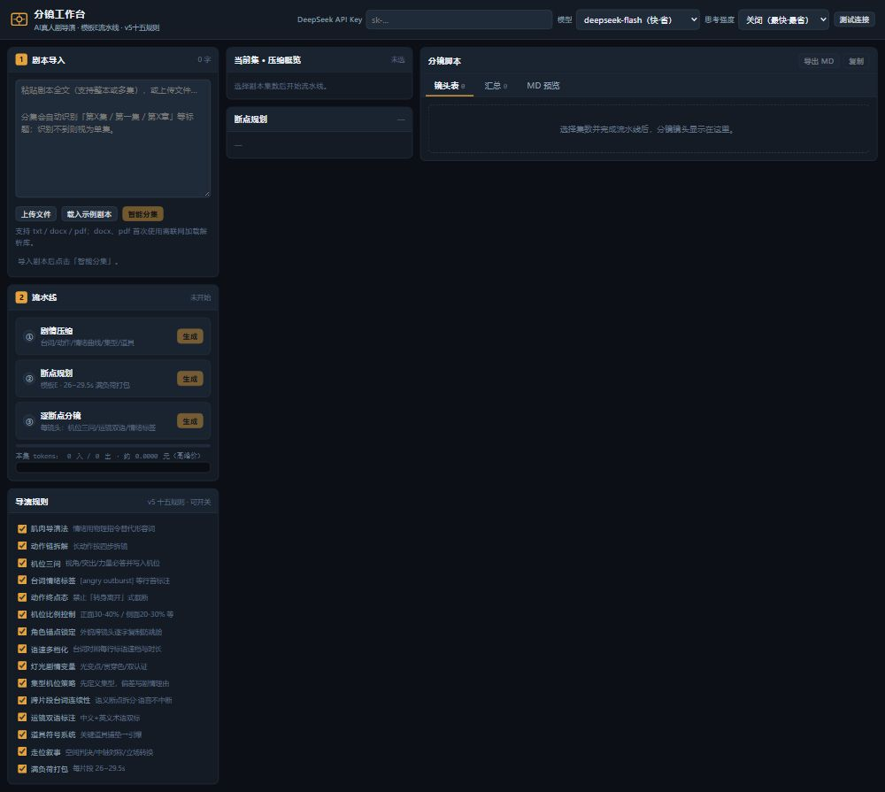
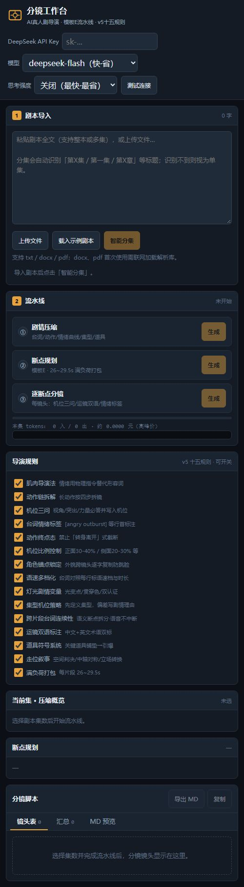

# 分镜工作台 · AI真人剧导演

单文件本地网页应用：上传剧本 → 智能分集 → 三步流水线（剧情压缩 → 断点规划 → 逐断点分镜）→ 导出模板E六段 Markdown 分镜脚本。配套完整「导演十五规则 v5」方法论文档。

**在线版**：https://storyboard-workbench-43699.app.workbuddy.host/
（也可下载后双击 `分镜工作台.html` 本地运行，数据不出本机）

## 界面预览

桌面端 | 移动端
--- | ---
 | 

## 目录结构

```
storyboard-workbench/
├── index.html                   # 主程序唯一真源（单文件自包含）
├── 分镜工作台.html               # index.html 的本地双击副本，由 tools/sync_single_file.py 生成，勿手改
├── LICENSE                      # MIT（代码）；docs/ 下的方法论文档另见「许可」一节
├── manifest.webmanifest         # PWA 清单（SVG + 192/512 PNG 三种图标）
├── sw.js                        # Service Worker 离线缓存
├── icon.svg                     # PWA 图标源文件（矢量）
├── icon-192.png / icon-512.png  # 由 tools/make_icons.mjs 从 icon.svg 生成
├── tools/
│   ├── check_inline_js.py       # 内联脚本语法校验（抽 <script> 逐个 node --check）
│   ├── sync_single_file.py      # index.html → 分镜工作台.html 同步（--check 只校验）
│   ├── build_site.py            # 生成部署目录 site/
│   ├── make_icons.mjs           # icon.svg → 192/512 PNG（无头 Chrome --screenshot，零依赖）
│   └── smoke_test.mjs           # 真实 Chrome(CDP) 冒烟测试，85 项断言 + 持久化往返
├── site/                        # 部署产物（build_site.py 生成，不入库）
├── README.md
└── docs/
    ├── 分镜方法论-v5/           # 导演十五规则完整文档（规则 v5）
    │   ├── SKILL.md             # 工作流总览：阅读理解→任务参数→场次灯光→逐镜头→自检→迭代
    │   ├── 改版说明.txt          # v5 版本演进与新增内容
    │   └── references/
    │       ├── director-rules.md        # 七基础：肌肉导演法/动作链/机位三问/情绪标签/终点态/机位比例/角色锚点
    │       ├── director-rules-v5.md     # 八进阶：语速多档/灯光变量/集型机位/跨片段台词/运镜双语/道具符号/走位叙事/满负荷打包
    │       ├── format-templates.md      # 五种输出模板（默认模板E：总结→断点→分镜→统计→对照→建议）
    │       ├── camera-movements.md      # 运镜库：适用场景与提示词写法
    │       ├── lighting-schemes.md      # 灯光方案库：光型/色温/色彩与情绪对应
    │       ├── pacing-and-revision.md   # 台词节奏、长台词细分、镜头时长与迭代修正
    │       └── special-angles.md        # 特殊视角与 9:16 竖屏构图
    └── preview/                  # 界面预览截图
```

> **版本口径**：本项目并行两套编号，**规则 v5** = 导演十五规则条数版，**排版 v6** = 多行式位置锚点等排版五规范版。两者维度不同，不要再混用「v5/v6」笼统指代。

## 其他电脑下载使用

**方式一：git 克隆**
```
git clone https://github.com/yangchang1206/storyboard-workbench.git
```

**方式二：直接下载 ZIP**
打开仓库页 → 绿色 `Code` 按钮 → `Download ZIP` → 解压。

任选其一后：
1. 双击打开 `分镜工作台.html`（浏览器直接运行，无需安装任何东西）
2. 在 [platform.deepseek.com](https://platform.deepseek.com) 创建 API Key，填入页面顶部
   （Key 与项目数据只存本机浏览器的 IndexedDB，不会上传到任何服务器）
3. 粘贴或上传剧本（txt / docx / pdf），「智能分集」后勾选目标集数（**可多选，会按集批量串行生成**）
   —— 可在「剧名」框填剧名，留空则自动按「上传文件名 → 剧本里的标题行」推断
4. 依次执行：剧情压缩 → 断点规划 → 逐断点分镜（可随时暂停/取消，支持断点级续跑）
5. 在导出区选模板（默认模板E 六段），「导出 MD」拿到分镜脚本；多集可「导出全部」并成合集
6. 「完整备份」把全部项目与设置导成一个 JSON，换电脑时用「导入」合并回来 —— 建议定期导一次

> 注意：docx / pdf 解析需联网加载解析库（顺序为「同源 `./vendor/npm/` → jsDelivr → unpkg」，任一可用即可）；txt 与粘贴无需联网。

## 特性

- **纯本地运行**：数据不出本机，无服务器、无注册
- **直连 DeepSeek API**（OpenAI 兼容协议）：`deepseek-flash` / `deepseek-v4-pro`，思考强度可调（关闭/低/中/高）
- **多集批量流水线**：勾选多集后一键批量生成，多选时自动跳过已完成的集；断点级续跑，暂停后可从缺口接着跑
- **导演十五规则（规则 v5）可开关**：界面 15 个开关真实生效，提示词按开关拼装
- **五种导出模板**：模板E 六段（默认）/ B 分镜表格 / C 表格＋灯光列 / D 剧情镜头 / A 即梦提示词，共用同一份数据，切换不需要重跑流水线
- **运行历史面板**：逐次记录模型、思考强度、token 三段、费用、耗时与成功/失败，可查详情、导出 JSON/CSV、清空
- **完整备份**：一键导出全部项目 + 导演规则开关 + 累计 token 统计；导入时是「合并」而非覆盖
- **存档健壮**：IndexedDB 主存（异步、配额按磁盘比例给）+ localStorage 降级；写不进去时保留旧存档并常亮告警，绝不覆盖腾地方
- **模板E 口径**：断点即生成片段（≤30s，满负荷打包 26~29.5s）、语速四档（喃喃3/常态3.5/对抗4/惊呼5 字每秒）、台词字数不含标点（仅汉字/字母/数字）
- **分镜表可编辑**：单镜头/整断点重生成，生成可暂停/继续/取消
- **成本透明**：按官方价目区分「输入缓存命中 / 未命中 / 输出」三段计价，按北京时间高峰·空闲档实时估算
- **不描述服饰/身材**：画面内容只写动作、表情、生理细节，外貌由人物参考图锁定

## 技术说明

- 单 HTML 自包含（内联 CSS/JS），无构建、无本地依赖
- DeepSeek 接口：`https://api.deepseek.com/chat/completions`
- 思考模式参数：`thinking: {type: enabled/disabled}` + `reasoning_effort: low/high/max`
  （思考模式下 `temperature` 不生效，因此代码只在「思考关闭」时才传，避免调参假象）
- 单次请求带 240s 超时，区分「用户暂停」与「网络超时」，不会静默卡死流水线
- 流水线分三阶段请求，分镜阶段只传断点上下文（不重复传整集全文），控制 token 成本

### 存储层（为什么不用 localStorage 存业务数据）

2026-10-14 在本机 Chrome 上实测的三个数字，直接决定了现在的实现：

| 实测项 | 结果 |
| --- | --- |
| localStorage 配额 | **5,241,856 字符**（5 MiB 的 UTF-16 码元，不是 5 MB 字节） |
| 80 集 × 8 断点 × 8 镜头 × 2 个项目 | 7,560,403 字符 = **144%**，必然溢出 |
| 旧版溢出后的落盘内容 | 只剩 `apiKey,model` 共 **38 字符** —— 等于把用户全部项目写没了 |
| 旧版 persist() 单次耗时 | 40 集 **31.2ms** / 80 集 **52.7ms**（同步阻塞，且挂在剧本框每次按键上） |
| 旧版存档冗余 | 601,102 字符里顶层摊平副本占 300,372 —— 同一份数据写了两遍 |

因此：**IndexedDB 作主存**（异步、配额按磁盘比例给，`file://` 双击打开也实测可用），
localStorage 只作降级通道与设置镜像；载荷只序列化 `projects` 一份；`persist()` 改防抖 700ms，
并在 `beforeunload` / `visibilitychange` 时补写。写不进去时**保留旧存档 + 顶栏常亮告警 + 引导导出完整备份**，
绝不为了腾地方覆盖数据。

## 开发与自检

改完 `index.html` 后按顺序跑一遍，再发布：

```bash
python tools/check_inline_js.py      # 内联脚本语法校验（单文件最容易死在这里）
python tools/sync_single_file.py     # 同步出 分镜工作台.html
python tools/build_site.py           # 生成部署目录 site/
node tools/make_icons.mjs            # 仅当改了 icon.svg 时需要：重新生成 192/512 PNG

# 冒烟测试：真实 Chrome 无头模式加载页面，断言关键逻辑 + 抓控制台报错
python -m http.server 8899 --bind 127.0.0.1   # 另开一个终端，在 site/ 目录下
node tools/smoke_test.mjs http://127.0.0.1:8899/index.html
node tools/smoke_test.mjs "file:///D:/项目/项目2/storyboard-workbench/index.html"   # 双击场景
node tools/smoke_test.mjs https://storyboard-workbench-43699.app.workbuddy.host/   # 线上
```

> 测试脚本用 Chrome 无头模式，本机若装了系统代理（如 Clash），需保证 Chrome 加 `--no-proxy-server`（脚本内已加），否则连 `127.0.0.1` 都会被代理拦掉。
> 冒烟测试除了页面内断言，还会**真的刷新一次页面**验证持久化往返（写 → reload → 读回），
> 因为存储层换成了异步 IndexedDB，只断言页面内函数不足以证明数据活得过页面加载。

## 规划中

- **BGM 配乐清单（模板E 第七段）** —— 规格是按情绪弧线从素材开头/中间/高潮/结尾截取，
  但需要先与 `drama-bgm-toolkit` 敲定**两项目共用的情绪词表**（该项目的 `MOOD_MAP` 用
  steady/climax/calm 能量标签 + 26~29.5s 时间轴，正好是本工作台断点的时间轴）。
  词表未定就实现会造出两套对不上的标签，故暂缓。
- 多模型接入
- 用真实 DeepSeek Key 端到端实测一次「测试连接」与三阶段流水线（目前模型名与价目仅对官方文档核对）

## 版本演进

- v1 模板E定型版 → v2 长台词细分版 → v3 机位三问版 → v4 导演七规则版 → v5 导演十五规则版
- **v1.6** —— 导出剧名推断修正：原 `dramaTitle()` 取「第一行非分集标记的内容」当剧名，实测会取到
  第一句台词或场景描述（如 `1993年，北方小城。`）。改为四级优先级：手填 > 上传文件名 > 剧本里「像标题」的一行 > 兜底，
  并新增「剧名」输入框（上传文件时以文件名预填）
- **v1.7（当前）** —— 存储层重构 + 运行历史 + 模板 A/B/C/D：
  - **修数据丢失缺陷**：原 `persist()` 在 localStorage 溢出时会把整个 key 覆盖成 `{apiKey,model}`，
    等于把用户全部项目写没（实测溢出后落盘只剩 38 字符）。现在改为保留旧存档 + 顶栏常亮告警 + 引导导出备份
  - **IndexedDB 主存**（localStorage 降级）；载荷去掉顶层摊平副本（实测省 50% 体积）；
    `persist()` 改 700ms 防抖 + 关页补写（原为剧本框每次按键同步写盘，80 集时单次 52.7ms）
  - **新增运行历史面板**：在 `callDeepSeek` 这唯一出口记账，三个阶段/单集/批量/成功失败自动入库
  - **新增完整备份**：导出全部项目 + 规则开关 + token 统计；导入改为「合并」且兼容单项目备份
  - **补齐模板 A/B/C/D 导出**：与模板E 共用数据，切换不重跑流水线
  - **补 PWA PNG 图标 192/512**（`tools/make_icons.mjs`），Service Worker 缓存升到 v3
  - 补 `LICENSE`（MIT）；冒烟测试扩到 **85 项断言**，并新增「写 → reload → 读回」持久化往返验证
- **v1.5** —— 缺陷修复版：
  - `esc()` 补转义 `"` `'`（模型输出含引号会撑破 `value="..."` 属性、破坏镜头表）
  - 多集勾选真正生效（原 `curEp()` 只取第一集，勾 10 集只跑 1 集）
  - **多集后可逐集查看**：顶栏「当前集」在多选时变成下拉框，点左侧集名也能切换；中栏压缩概览 / 断点规划、右栏镜头表、MD 预览与导出一律跟随当前查看集
  - 分集列表显示每集完成度（`压`/`规`/`镜`）；新增「导出全部（N 集）」，把已出分镜的选中集并成一个合集文件
  - 峰谷判定改用固定北京时间（原用本机时区，非东八区机器费用整体偏移）；周末=空闲符合官方口径
  - 费用估算区分输入「缓存命中 / 未命中 / 输出」三段单价，并修正 token 跨模型混算导致的费用虚高
  - 思考模式下不再传无效的 `temperature`；单次请求加 240s 超时，区分暂停与超时
  - 解析库加载加同源/unpkg 兜底，pdf.js 显式配置 worker；Service Worker 缓存可随版本失效
  - 剧本改动不再静默清空分集勾选，改为显式提示「建议重新分集」
  - 新增「导出含机位/视觉建议」开关（v1.3 起默认不输出，需要机位三问答案时勾上）
  - 统一版本口径为「规则v5 / 排版v6」；补 `.gitignore` 与自检工具链

> 模型名与价目表核对结论（2026-10-14 官方文档）：模型名以 `deepseek-flash` 为准，旧名 `deepseek-v4-flash` 已下线但仍可调用、同价；现价 flash = 命中 0.04/0.02、未命中 2/1、输出 8/4（元/百万 tokens，高峰/空闲），pro = 0.30/0.15、9/4.5、27/13.5。代码与官方一致。

## 许可

- **代码**（`index.html`、`tools/`、`sw.js`、`manifest.webmanifest` 等）：[MIT](LICENSE)，Copyright (c) 2026 yangchang1206
- **方法论文档**（`docs/分镜方法论-v5/` 下的 `SKILL.md`、`references/*`、`改版说明.txt`）：
  署名—非商业性使用 4.0 国际（CC BY-NC 4.0）。可自由参考与改编，**不得用于商业用途**，转载需署名。
- **运行时第三方库**（不随仓库分发，由页面在运行时从 CDN 加载）：
  - `mammoth@1.8.0`（docx 解析）—— BSD-2-Clause
  - `pdfjs-dist@3.11.174`（pdf 解析）—— Apache-2.0

  目前仓库不含这些库的代码，因此无需随附许可。但若为离线使用而建立 `vendor/`（`build_site.py` 支持该目录
  并会一并部署），则**必须同时带上这两个库的 LICENSE 文件** —— Apache-2.0 的这一条是硬性要求。
